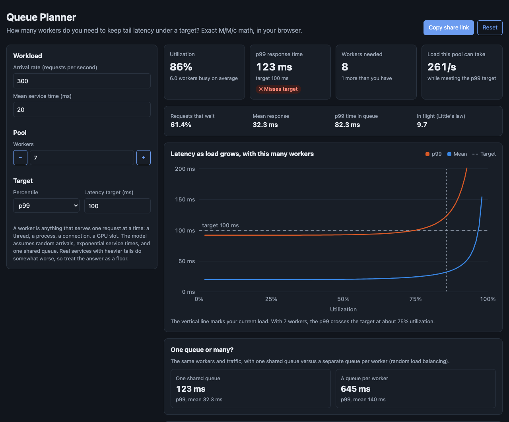

# Queue Planner

A browser tool for sizing a pool of workers. Give it your traffic, how long one request takes, and a latency target like "p99 under 100 ms". It tells you how many workers you need, how much load your current pool can take, and where latency starts to climb.



## Why

Capacity plans often say "we run at 70% CPU, so we have 30% headroom". Latency does not work that way. As a pool gets busier, more requests find every worker occupied and wait, and the wait grows faster and faster as utilization approaches 100%. A pool that looks fine at 70% can miss its p99 target at 85%.

Queueing theory has exact answers for this, and they fit in a few lines of code. This tool puts them behind a form so the answer is quick to check in a design review.

## What it shows

- **Utilization, the target percentile, and a pass or fail verdict** for the current pool.
- **Workers needed:** the smallest pool that meets the target.
- **Load this pool can take:** the highest arrival rate that still meets the target. This is the number to alert on, not CPU.
- **The hockey stick:** mean and percentile latency across utilization for the current pool, with the target line and your current load marked.
- **One queue or many:** the same traffic with one shared queue versus a queue per worker. With the defaults, a shared queue gives 123 ms at p99 and separate queues give 645 ms. This is why a load balancer that sends work to idle workers beats random assignment.
- **A table of worker counts** with utilization, the share of requests that wait, mean, and percentile.
- **Little's law:** how many requests are in flight on average, which is what you size connection pools and memory for.

Inputs live in the URL, so "Copy share link" captures the whole plan.

## The model

It is an M/M/c queue: random (Poisson) arrivals, exponentially distributed service times, c identical workers, and one first-come-first-served queue.

- The chance that a request waits is the Erlang C formula, computed with the numerically stable Erlang B recurrence so it works for pools of hundreds of workers.
- The waiting time is 0 with probability 1 - C, and otherwise exponential with rate cμ - λ.
- Response time is wait plus service. Its tail has a closed form, and percentiles are found by bisection on that tail.

A test checks the percentile against a 200,000-request simulation and agrees within 3%.

Real services rarely have exponential service times. Heavier tails, like garbage collection pauses or cache misses, make the wait longer. Treat the answer as a lower bound and leave headroom.

## Run it

It is a static site with no build step and no dependencies.

- **GitHub Pages:** enable Pages for the repo and serve from the root of the default branch.
- **Locally:** ES modules need a web server, so `file://` will not work. From this folder run:

```bash
python3 -m http.server 8000
```

Then open http://localhost:8000.

## Tests

The math lives in `src/queue.js` with no DOM code, so it runs under Node's built-in test runner.

```bash
npm test
```

16 tests cover Erlang C against textbook values, the M/M/1 special case, Little's law, the simulation check, overload, the minimum worker search, and URL round-trips.

## License

MIT. See [LICENSE](LICENSE).
